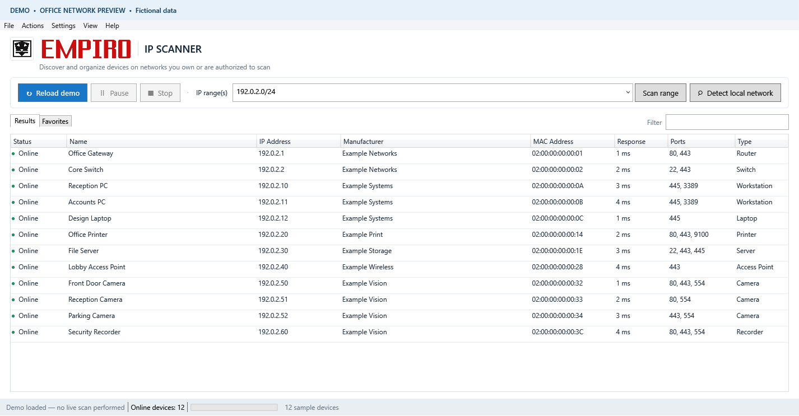

# Empiro IP Scanner

Empiro IP Scanner is a native Windows desktop tool for discovering responding devices on IPv4 networks you own or are authorized to scan. A simple, powerful interface brings together device discovery, favorites, scan history, exports, and optional camera monitoring. This is a separate project from Empiro Network Scanner.

## At a glance

**Primary language: C# · Framework: .NET 8 / WPF · UI markup: XAML · Tests: xUnit**



This image shows synthetic demo data, not a live scan. [View all five screenshots](docs/SCREENSHOTS.md).

## Documentation

- [Portfolio case study and interview guide](docs/PORTFOLIO.md)
- [Architecture and technology](docs/ARCHITECTURE.md)
- [User guide and offline demo](docs/USER_GUIDE.md)
- [Build, tests, screenshots and releases](docs/DEVELOPMENT.md)
- [GitHub preparation status](docs/GITHUB_PREPARATION.md)

## Try the offline demo

```powershell
dotnet run --project .\src\Empiro.IpScanner.Wpf --configuration Release -- --demo
```

No office network is needed. The demo uses 12 fictional devices and does not load or save live state. Network actions are disabled in demo mode. See the user guide for a five-minute walkthrough.

## Features

- Scan one IPv4 address, an inclusive start–end range, CIDR notation, or multiple ranges separated by semicolons (for example, `192.168.29.0/24; 192.168.100.0/24`).
- Send standard ICMP echo requests with bounded asynchronous concurrency, configurable timeouts, pause, cancellation, and progressive table updates.
- Use active ARP resolution for same-subnet devices that do not answer ping, and optional RTSP service checks plus ONVIF multicast discovery for cameras.
- Show only responsive devices in Results. Devices found by ONVIF may be outside the typed IP ranges when they are on a local network interface that can receive the discovery multicast.
- Resolve reverse hostnames and local MAC addresses when Windows can provide them. Manufacturer names use a small offline OUI map and otherwise show `Unknown`.
- Optionally check user-configured TCP ports. Port checks only attempt TCP connections; they do not authenticate or exploit services.
- Filter and sort results, save favorites and comments, rename devices, review scan history, and export CSV, JSON, or TXT.
- Context actions include ping, traceroute, HTTP/HTTPS, FTP, SSH, RDP, Telnet, copy, rescan, and Wake-On-LAN.
- Detect local adapter, IPv4, subnet, gateway, DNS, and suggested CIDR range.
- Open **Actions → Camera AI monitor** to discover ONVIF cameras, resolve an RTSP stream URI using camera credentials, connect to streams, and display YOLO detections with confidence overlays.
- Monitor streams off the UI thread, reconnect with backoff after stream failures, and drop stale frames instead of queuing them behind inference.
- Run supported YOLOv8/YOLO11 detection ONNX models with ONNX Runtime CUDA when initialized successfully, otherwise use its CPU execution provider.
- Settings, range history, favorites, comments, and scan history are stored as JSON under the current user's Local AppData.

Scans are limited to 4,096 unique addresses at a time. The default is the detected local network. Public address ranges require an explicit authorization confirmation. ARP discovery is limited to on-link IPv4 addresses; ONVIF multicast generally does not cross routers or VLANs. Devices that block ping and ARP, do not expose checked TCP ports, and do not answer ONVIF discovery may not appear. Manufacturer identification is best-effort and may remain unknown when a MAC/OUI is unavailable or absent from the bundled offline map.

## Build and test

### Discovery across IP subnets on a local link

Camera discovery searches all active local IPv4 interfaces using ONVIF WS-Discovery and Hikvision SADP (UDP multicast 239.255.255.250:37020). Both the scanner and camera monitor use this discovery. SADP reads the advertised IPv4 address, model description, MAC and manufacturer without logging in or changing camera settings. ONVIF and SADP results are combined by IPv4 address while retaining the ONVIF service URL. SADP identifies video devices, including recorders; it does not prove that a device supports ONVIF or RTSP.

A PC at 192.168.1.20 may discover a camera reporting 192.168.29.20 on the same physical network if its firmware replies and multicast/firewalls permit it. This is best-effort local-link discovery, not discovery through arbitrary routers or isolated VLANs. Opening the web interface or streaming still requires routing or an appropriate secondary local IP. Empiro does not change adapter addresses or firewall rules. Other proprietary manufacturer protocols are not implemented. Hardware compatibility must be checked with the intended cameras.

Protocol references: [Hikvision communication matrix](https://www.hikvision.com/content/dam/hikvision/products/S000000001/S000000002/S000000007/S000000026/OFR000042/M000032099/Communication_Matrix/Hikvision-NVR-and-DVR-Product_Communication-Matrix_Baseline_20200429.pdf), [SADP simulator packet format](https://github.com/shranet/hikvision-virtual-cam/blob/main/internal/sadp/server.go), [ONVIF Core specification](https://www.onvif.org/specs/core/ONVIF-Core-Specification-v260.pdf).

Requirements: Windows 10/11 x64 and .NET 8 SDK. Inno Setup 6 is needed only to build the installer. The camera monitor uses Emgu.CV and ONNX Runtime GPU Windows packages, restored by NuGet. Run:

```powershell
dotnet test .\Empiro.IpScanner.sln
dotnet build .\Empiro.IpScanner.sln --configuration Release
```

To publish a self-contained single-file x64 app and create its installer:

```powershell
.\build_windows.ps1
```

The script runs tests, publishes the app with the .NET runtime included, and creates `dist\Empiro-IP-Scanner-Setup-1.1.2-x64.exe`. End users do not need to install .NET. The installer is per-user and offers an optional desktop shortcut.

### Camera monitor setup

1. Open **Actions → Camera AI monitor** and click **Scan Network (ONVIF)**. WS-Discovery is local-link multicast; it generally does not pass routers, VLANs, or Wi-Fi client isolation.
2. Select a camera, enter its ONVIF username and password under **Build URL from camera fields**, and choose **Resolve RTSP with ONVIF credentials**. Cameras using only an HTTP authentication mode unsupported by their ONVIF endpoint may need a manually supplied RTSP URL.
3. If automatic resolution is unavailable, enter the camera's documented RTSP path and credentials in the builder (the displayed path is only a common default), or paste a complete RTSP URL.
4. Select the compatible `.onnx` detection model and connect. Optionally put a `coco.names` file beside the model to override the built-in COCO class labels.

The detector supports standard Ultralytics YOLOv8/YOLO11 detection exports with a single three-dimensional detection output and fixed NCHW input dimensions (commonly 640×640). It letterboxes camera frames and maps the detections back to source pixels; exports needing different preprocessing, segmentation, or a different output layout need a matching adapter. The ONNX Runtime CUDA provider requires a compatible NVIDIA driver and CUDA/cuDNN libraries on the target system; if it cannot initialize, inference starts on CPU. The app does not include or download an ONNX model. Check the model's license and compatibility before use. RTSP URLs may contain credentials and are not persisted by the camera monitor.

## Responsible use

Only scan systems and networks that you own or have permission to assess. Empiro does not perform stealth scanning, bypass authentication, collect credentials, or exploit services.

## Repository layout

- `src/Empiro.IpScanner.Core`: discovery, scan scheduling, address parsing, and local state.
- `src/Empiro.IpScanner.Wpf`: Windows desktop interface and optional camera monitor.
- `tests/Empiro.IpScanner.Tests`: address parsing and discovery tests, including a loopback integration check.
- `tools`: optional branding asset generation (Python with Pillow); generated application assets are already included.
- `build_windows.ps1` and `EmpiroIPScanner.iss`: self-contained Windows packaging.

The SDK baseline is recorded in `global.json`; NuGet package versions are specified in the project files. Run commands from the repository root. No model, camera credentials, saved scan results, or local SDK is included.

## Release status

The source version is 1.1.2, with subsequent camera discovery changes present. The previously installed 1.1.2 executable is not proof of a build from this source. Build and test this repository before publishing a new installer. Hardware camera discovery and streaming require separate verification on the intended network and devices.

Installers should be attached to GitHub Releases, not committed to source control. See `docs/GITHUB_PREPARATION.md` for preparation status.

## License

Copyright (C) 2026 Vineet Kumar and contributors.

This project is licensed under the GNU General Public License version 3 only (GPL-3.0-only). See [LICENSE](LICENSE). Third-party dependencies retain their own licenses; see [THIRD_PARTY_NOTICES.md](THIRD_PARTY_NOTICES.md). No model weights are bundled.
