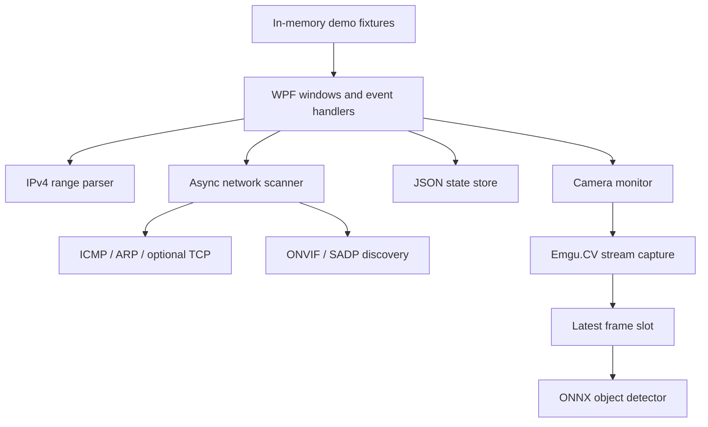

# Architecture and technology

Empiro IP Scanner is a Windows desktop application with a separate core library and test project. It is distinct from Empiro Network Scanner.

## Technology stack

| Technology | Purpose |
|---|---|
| C# / .NET 8 | Application logic, asynchronous scanning, device models, persistence, tests |
| WPF / XAML | Windows UI, layouts, bindings, resources, menus and dialogs |
| PowerShell | Build, test, publish and installer orchestration |
| Inno Setup script | Per-user Windows installation and shortcuts |
| Python / Pillow | Optional generation of branding assets; not the scanner runtime |
| JSON | Local settings, favorites, history and exported data |
| xUnit | Automated .NET tests |
| Emgu.CV / ONNX Runtime | Optional camera capture and object detection |

The SDK baseline is 8.0.425 in `global.json`. Package versions are explicitly recorded in the `.csproj` files. The current GUI is C#/WPF; an older Python implementation is not included in this repository.

## Components

`Empiro.IpScanner.Core` contains address parsing, bounded scanning, discovery, network detection, state storage and demo fixtures. `Empiro.IpScanner.Wpf` contains XAML windows, code-behind orchestration, export/actions and camera monitoring. `Empiro.IpScanner.Tests` exercises core behavior.

This is a layered desktop application with event handlers and data binding. It does not currently implement a full MVVM or dependency-injection architecture. A useful next refactor is to move presentation orchestration from `MainWindow` into view models and inject network/state services.

## Scan flow

1. Parse individual addresses, ranges and CIDR input; deduplicate and enforce the 4,096-address limit.
2. Confirm authorization for non-private targets in the live UI.
3. Probe using bounded asynchronous work, timeout/retry settings and cancellation tokens.
4. Use optional local ARP, TCP service checks and discovery responses to enrich results.
5. Report progressive results to the UI and merge by IP address.
6. Update favorites and history; save local state after completion.

ONVIF and SADP are best-effort local-link discovery. Finding a device with a different IP subnet does not guarantee that its web interface or stream is reachable. Routers, VLANs, multicast filtering and camera firmware affect results.

## Persistence and camera pipeline

`AppStateStore` writes JSON to the user's Local AppData under `Empiro/Empiro IP Scanner/state.json`, using a temporary file followed by replacement. It stores settings, favorites, comments, renamed devices and history. This is local-file persistence, not a database or a multi-user service.

Camera monitoring resolves a stream using ONVIF or accepts an RTSP URL. Capture and inference run off the UI thread. A latest-frame slot limits stale-frame buildup; reconnect uses backoff. Supported detection exports use a fixed NCHW input and a compatible YOLO-style output. The app does not train models or bundle weights. CUDA execution is attempted when available, with a CPU inference fallback.

## Demo isolation

`--demo` loads deterministic fixtures before loading live state. Scan entry points reload fixtures; adapter detection and device network tools do not run; camera monitoring is blocked. Saving demo settings is a no-op. Explicit export remains available. `--render-demo` implies demo mode and renders five actual WPF views to PNG; only this renderer selects software graphics rendering.
