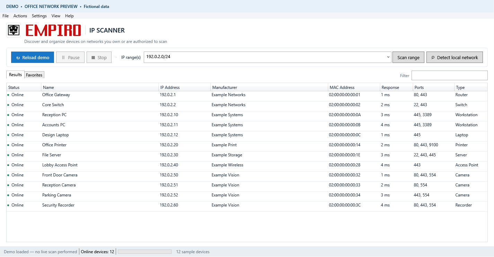
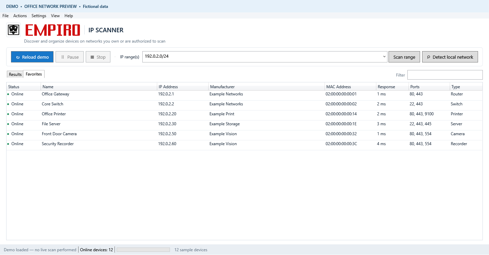
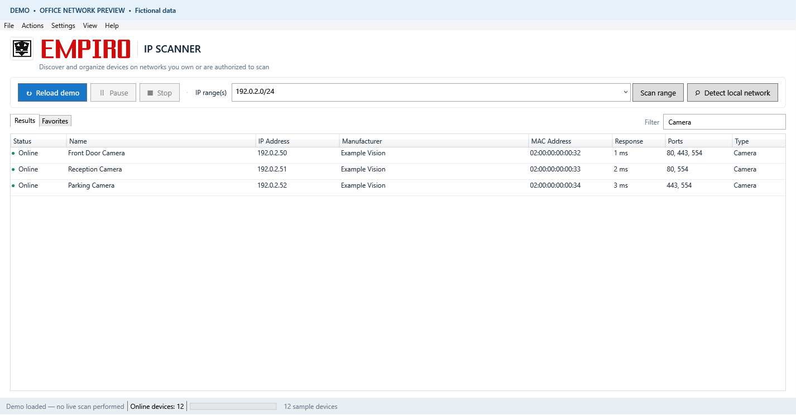
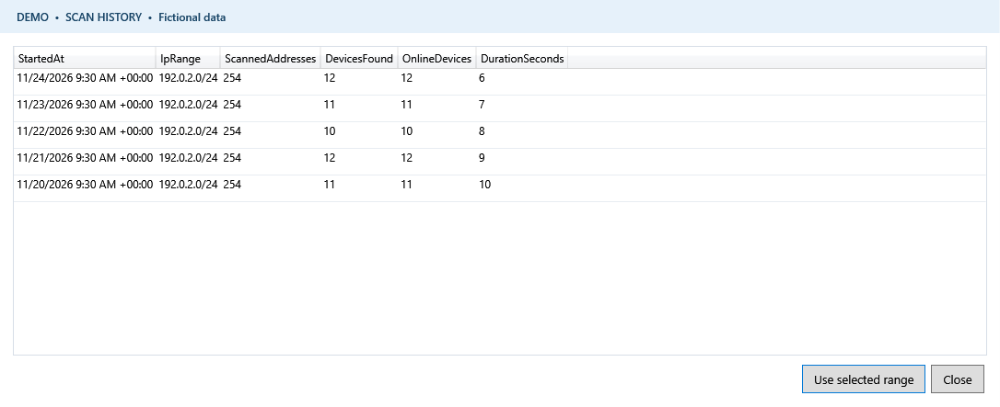
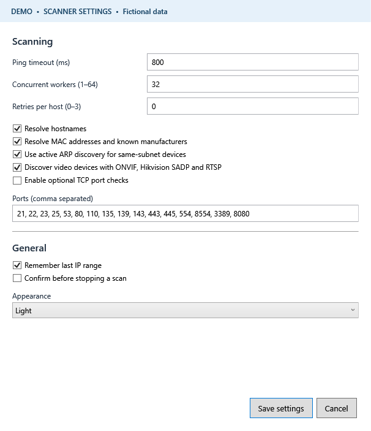

# Application screenshots

These five PNGs were rendered directly from Empiro IP Scanner's WPF views. All device identities, MAC addresses, vendors, history entries and measurements are fictional. No office network was contacted. Each image carries a demo banner.

## 1. Scan results

## 2. Favorites

## 3. Camera filter

## 4. Scan history

## 5. Settings

